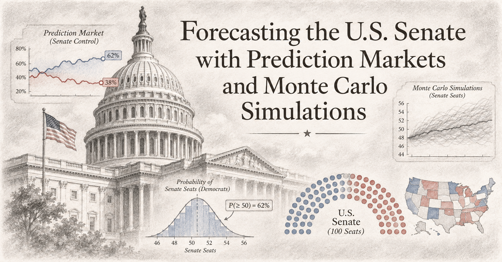
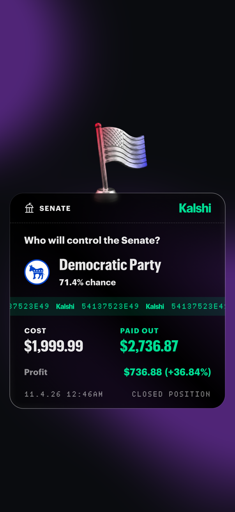
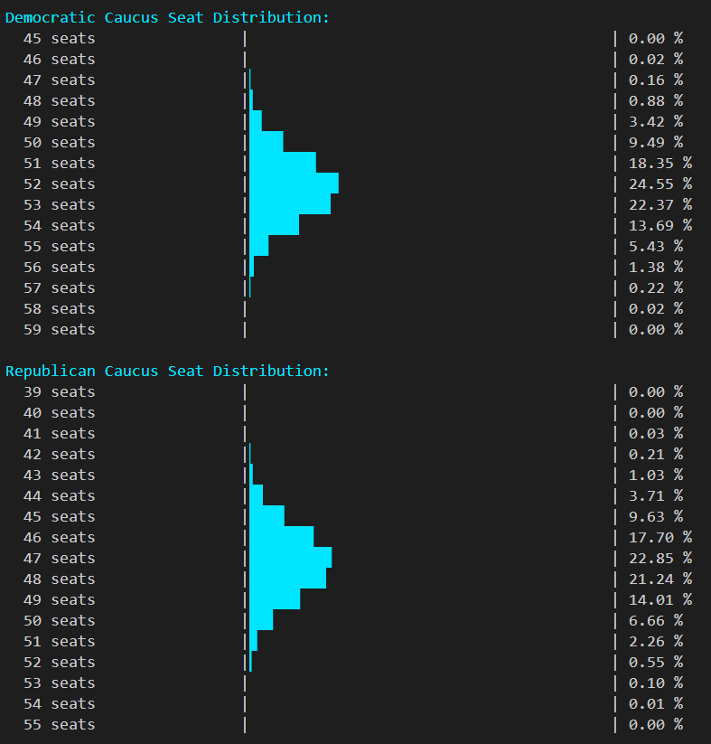
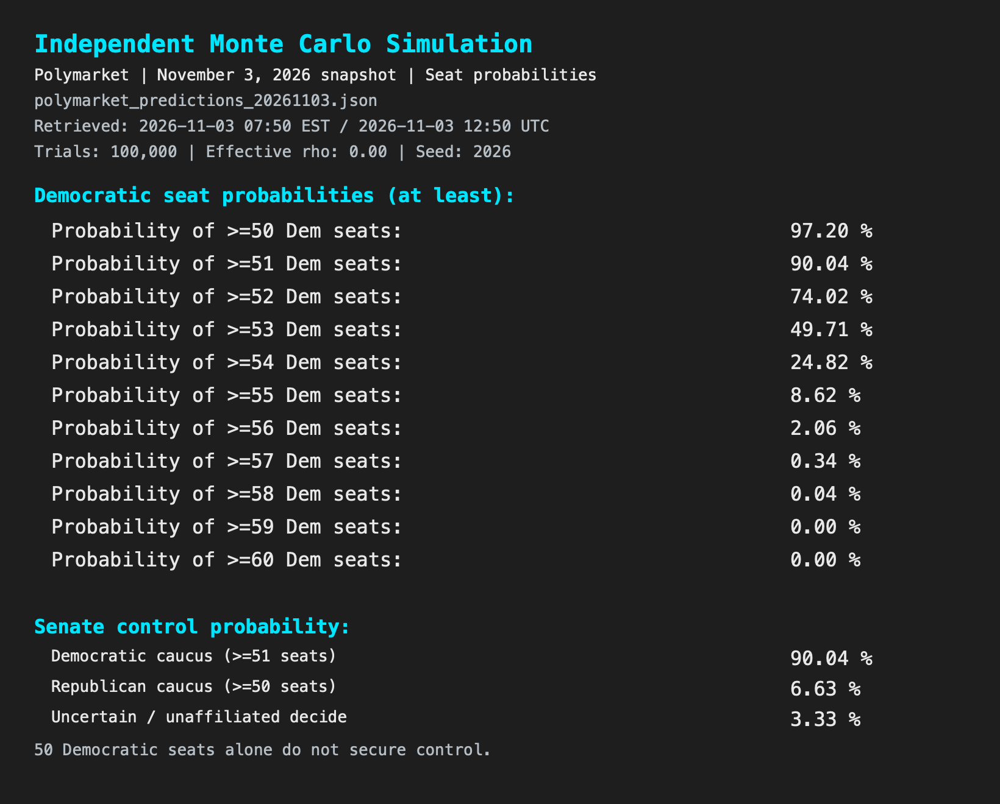
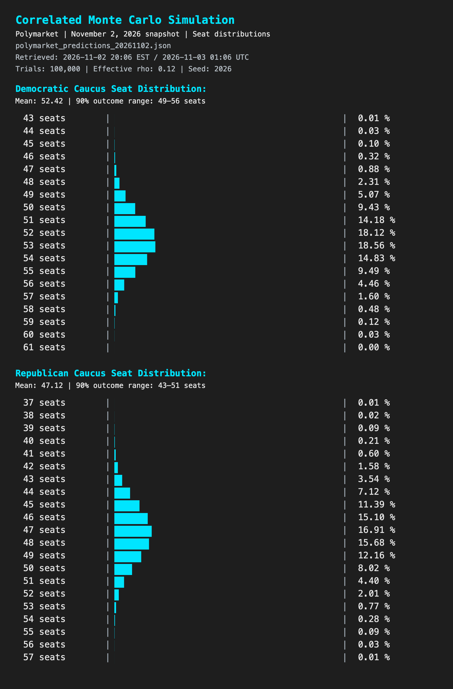
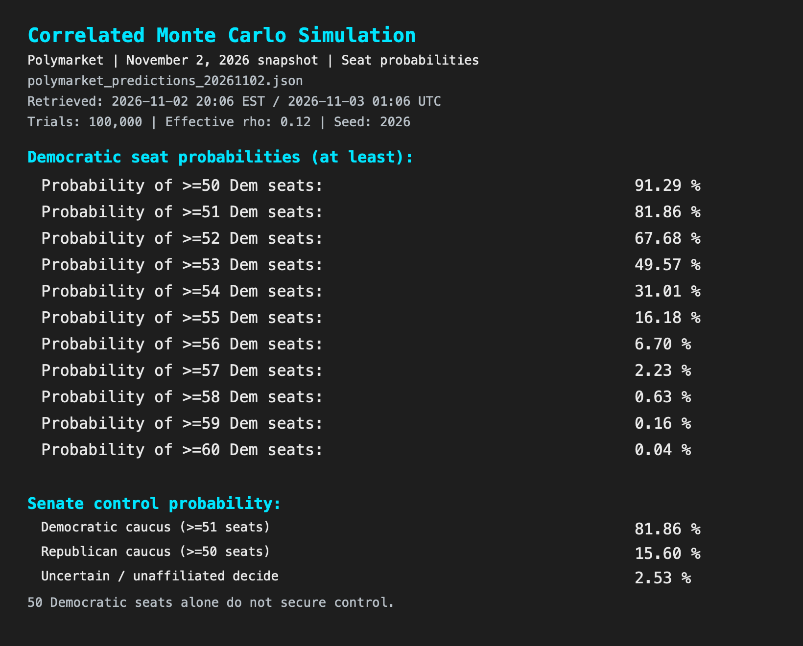

# US Senate Elections Forecast



**Update 11.04.2026**

I backed my forecasts with actual positions on Kalshi! Here are the closed Senate and House bets, where my 11.01.2026 Senate model showed roughly a 14% edge for Democrats.

<p align="center">
  <a href="https://github.com/bartczernicki/USSenateElectionsForecast/blob/main/USSenateElectionsForecast/Images/KalshiResults/KalshiSenatePosition.png">
    
  </a>
  <a href="https://github.com/bartczernicki/USSenateElectionsForecast/blob/main/USSenateElectionsForecast/Images/KalshiResults/KalshiHousePosition.png">
    
  </a>
</p>

## What is this & Why might it be interesting?

- A .NET 10 console application that forecasts the 2026 U.S. Senate elections using [Polymarket](https://polymarket.com/) or [Kalshi](https://kalshi.com/) probabilities, Monte Carlo simulations, and direct probability calculations.
- Polymarket predictions (especially when the forecast is coming to resolution) is highly calibrated, which makes individual predictions effective intelligence points for forecasts.
- **Model wave elections:** a shared national factor lets races move together, capturing scenarios such as a Democratic or Republican wave.
- **The average doesn’t tell the whole story:** correlation preserves individual Senate race probabilities and expected seat totals while changing the likelihood of unusually large gains or losses.
- **Why do the math?** When the data and tools are available, you make the forecast decisions explainable, reproducable and generally more accurate.

## Assumptions & Configurations

- Simulation count: 100,000 default | Rho: 0.12
- Rho links underlying race scores: 0 = independent; higher = more shared national swing.
- Shared polling errors motivate correlation ([Nate Silver's FLIPR methodology](https://www.natesilver.net/p/flipr-midterms-model-methodology)).
- Default 0.12: 12% national / 88% local score variance; this app's assumption, not Silver's.
- Default source: Polymarket | Predictions file: `polymarket_predictions_20261103.json`
- Kalshi snapshot: `kalshi_predictions_20261103.json` (same 35 races; refreshed 2026-11-03 07:50 EST / 2026-11-03 12:50 UTC)
- Election: 2026 | Races: 35 | Polymarket refreshed: 2026-11-03 07:50 EST / 2026-11-03 12:50 UTC

## Run and configure

Install the .NET 10 SDK, then run from this directory:

```powershell
dotnet run --project USSenateElectionsForecast
```

Choose a numbered calculation method or **5) Configure**. Use `0` to go back or exit, and press Enter after an action to return. Ctrl+C cancels a calculation or refresh.

Under **Configure**:

- **Configure Rho (Correlation)**: set rho from 0 through 0.99 using a decimal point. Blank input keeps the current value; saved settings persist across restarts. What is Rho? Rho is a proxy for the "Democratic Wave". The US Senate elections are independent state elections, but in the overall environment in the country, there is some correlation between the races. This number represents how correlated they are. What is super interesting is that it doesn't change the expected outcome (average), but it expands the tails of the distribution. More extreme events (upsets) happen. 
- **Configure Simulation Count**: a whole-number count from 1,000 through 10,000,000. Blank input keeps the current value; saved settings persist across restarts.
- **6) Select Prediction Source**: choose Polymarket or Kalshi. Polymarket is the default for new and existing settings. Switching sources selects that source's latest valid saved snapshot and persists across restarts. If no valid snapshot is available, the previous source and selection are retained.
- **Select Predictions File**: choose a dated snapshot or **Latest available** for the selected source. A specific selection persists across restarts until changed or a successful refresh returns selection to **Latest available**. Selecting a source or file uses saved data without downloading anything.
- **List Current US Senate Probabilities**: view the selected snapshot, sorted by the closest races first. The menu shows the active source beside options 4 and 6, and the active filename beside option 5. Closeness is the gap between a race's two highest normalized outcome probabilities.
- **Update Predictions (Polymarket/Kalshi)**: manually fetch current prices from the selected source. Public market data requires no account, wallet, or API key. Downloads never happen automatically.

## Calculation methods

- **1) Independent Monte Carlo Simulation**: sample each race separately for the configured number of election trials; rho is ignored.
- **2) Correlated Monte Carlo Simulation**: sample election trials with a shared national factor that moves races together while preserving each race's win probabilities.
- **3) Conditional Monte Carlo**: use the configured count to sample national environments, calculate a complete seat distribution for each, and average those distributions.
- **4) Direct Probability Calculation**: calculate independent and correlated results without sampling; the simulation count is ignored.

The correlated results in options 2, 3, and 4 use the same model. More samples reduce calculation noise; election uncertainty remains.

## Simulation Results

These results use the saved November 3 Polymarket snapshot, retrieved at 2026-11-03 07:50 EST / 2026-11-03 12:50 UTC. Each model runs 100,000 trials with its own random generator seeded with `2026`.

### Independent Monte Carlo

- **Average seats:** 52.46 Democratic, 47.04 Republican.
- **Control probability:** 90.04% Democratic, 6.63% Republican.
- **90% outcome range:** 50–55 Democratic seats, 44–50 Republican seats.





### Correlated Monte Carlo

- **Correlation:** rho = 0.12.
- **Average seats:** 52.46 Democratic, 47.04 Republican.
- **Control probability:** 82.62% Democratic, 14.71% Republican.
- **90% outcome range:** 49–56 Democratic seats, 43–51 Republican seats.
- **Chance of 55+ Democratic seats:** 16.44%, compared with 8.62% in the independent simulation.
- **Effect of correlation:** wider outcome ranges with unchanged race probabilities and expected seats; small differences in simulated averages are sampling noise.






## Prediction data and refreshes

- [Polymarket's public Gamma API](https://docs.polymarket.com/market-data/discover-markets) supplies market-implied prices. Each race's mutually exclusive Yes prices are divided by their total to produce probabilities that sum to one.
- [Kalshi's public REST API](https://docs.kalshi.com/getting_started/quick_start_market_data) supplies the midpoint of each contract's Yes bid and ask. These midpoints are divided by their race total in the same way. Missing or unusable quotes fail the refresh; there is no fallback to last trades or the other provider.
